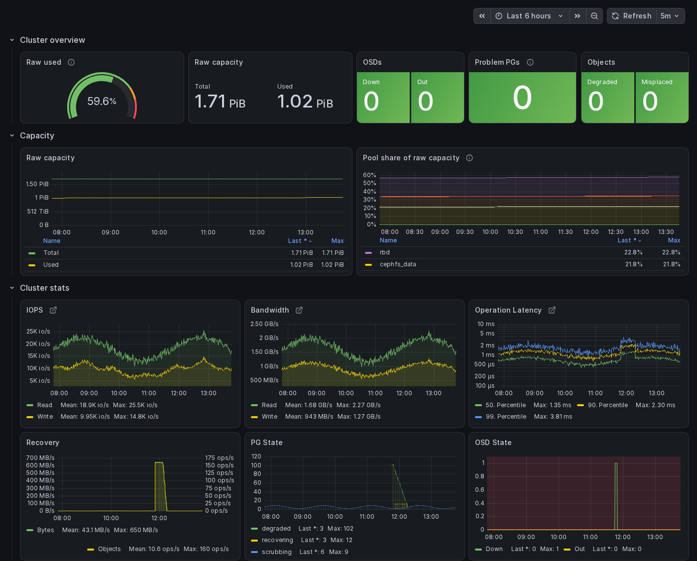

# Grafana Dashboards for croit
Grafana dashboards to monitor Ceph clusters deployed with croit.
They read the metrics croit already collects from every node, through croit's Graphite API.



## Dashboards

* **croit - Main Dashboard**: the cluster at a glance. Raw capacity used, OSDs down or out, PGs in problem states, degraded and misplaced objects, each pool's share of the raw capacity, IOPS, bandwidth, latency, recovery, the fill level of every OSD, and IO and CPU load per server.
* **croit - Per-Pool Stats**: usage, share of the raw capacity, IOPS and bandwidth per pool.
* **croit - CPU Overview** and **croit - Disk Overview**: CPU, memory, system load, disk IO and disk usage per server.
* **croit - Latency Overview**: OSD operation latency percentiles, split into reads, writes and sub-operations.
* **croit - RadosGW S3 Buckets** and **croit - RadosGW S3 Users**: data and object usage per S3 bucket and user.

## Requirements

* Grafana 7.4 or later. The dashboards are tested with Grafana 13.
* Network access from Grafana to the croit management node on port 8080 (HTTP) or 443 (HTTPS).
* A croit user with the viewer role. Grafana uses it to read the metrics.

## Setting up Grafana
The easiest way to install Grafana is using Docker.
Use the following command when deploying on the same server as the croit application:

```
sudo docker run --net=host -d --name=grafana -e "GF_SECURITY_ADMIN_PASSWORD=<set-grafana-password-here>" grafana/grafana
```
Grafana will be available on port 3000 by default. Replace the password for the initial Grafana admin user. See [Grafana documentation](https://grafana.com/docs/grafana/latest/setup-grafana/installation/docker/) for further options.

You can also use an existing Grafana instance that meets the requirements above.

## Adding a data source
In Grafana, go to *Connections > Data sources > Add data source*, pick *Graphite* and set:

* Name: `croit`
* URL: `http://localhost:8080/graphite/` when Grafana runs on the croit management node. Otherwise use `http://<croit-host>:8080/graphite/`, or `https://<croit-host>/graphite/` for HTTPS. Over HTTPS, Grafana must trust the certificate croit's web UI uses.
* Authentication: *Basic authentication*, with the user name and password of a croit user with the viewer role.

Leave the other settings at their defaults and click *Save & test*.

## Importing the dashboards
Go to *Dashboards > New > Import*, upload one of the JSON files from this repository and select the `croit` data source when asked. Repeat for each dashboard you want.

## Things to know

* Servers appear under croit's server ID (`server-1`, `server-2`, ...), not their host name.
* Pool names show dots as dashes, for example the `.mgr` pool appears as `-mgr`.
* Raw capacity counts every copy: a pool with three replicas uses three times the data it stores, an erasure-coded pool uses its data plus the coding chunks.

## Alerts
Two dashboards still carry alerts in the format of Grafana's legacy alerting (OSD state on the Main Dashboard, operation latency on the Main Dashboard and the Latency Overview).
Grafana 11 and later ignore them.
To be alerted, create alert rules under *Alerting > Alert rules* from the queries of those panels, see the [Grafana alerting documentation](https://grafana.com/docs/grafana/latest/alerting/).
